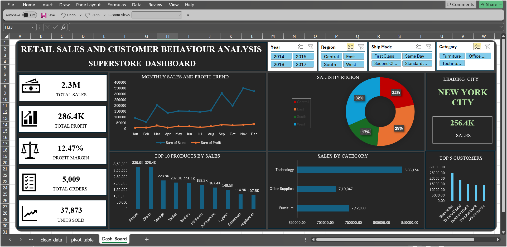
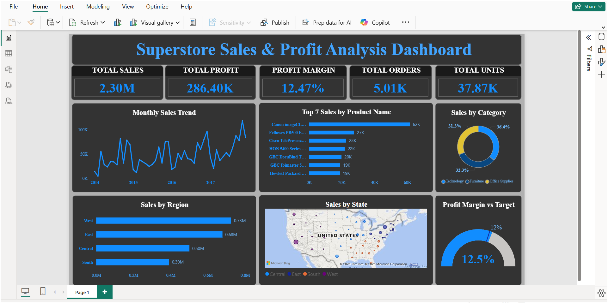

# Retail Superstore Sales Analysis

## Project Overview
An end-to-end retail sales analysis project using Excel, SQL, Python, and Power BI to analyze sales performance, profitability, product performance, and regional trends.

## Business Objectives
- Monitor overall sales, profit, and profit margin.
- Identify top-performing products and categories.
- Analyze monthly sales trends.
- Compare sales performance across regions.
- Explore profitability to support business decisions.

## Tools and Technologies
- **Excel:** Interactive dashboard, PivotTables, PivotCharts, slicers, and KPI reporting.
- **MySQL:** Data import, SQL queries, aggregations, joins, and business analysis.
- **Python:** Pandas, NumPy, and Matplotlib for data analysis and visualization.
- **Power BI:** Interactive dashboard, DAX measures, KPI cards, and slicers.

## Project Structure
- `Dataset/` — Cleaned Superstore dataset.
- `Excel/` — Excel dashboard and screenshot.
- `SQL/` — SQL analysis script and Python import script.
- `python/` — Python analysis export.
- `PowerBI/` — Power BI report, screenshot, and video.

## Key Performance Indicators
- Total Sales
- Total Profit
- Profit Margin
- Total Orders
- Units Sold

## Dashboards

### Excel Dashboard

### Power BI Dashboard

## Key Analysis Areas
- Monthly sales trends
- Sales by region and category
- Top-performing products
- Profitability by sub-category
- Sales and profit KPI monitoring

## How to Use
1. Download or clone this repository.
2. Open the Excel workbook to explore the dashboard and slicers.
3. Run the SQL script in MySQL after configuring the database and importing the dataset.
4. Open the Python analysis file to review the analysis.
5. Open the `.pbix` file in Power BI Desktop to interact with the dashboard.

## Project Outcome
This project demonstrates practical skills in data analysis, data visualization, SQL querying, dashboard development, and business KPI reporting.

